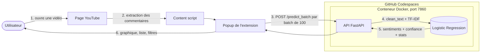
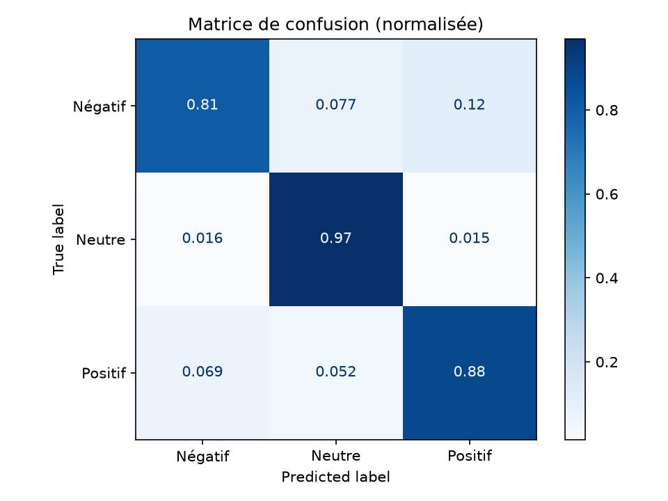

# Analyse de sentiment des commentaires YouTube

Système MLOps complet qui analyse automatiquement le sentiment (positif, neutre, négatif) des commentaires d'une vidéo YouTube : un modèle scikit-learn (TF-IDF + Logistic Regression) servi par une API FastAPI conteneurisée avec Docker et déployée dans le cloud (GitHub Codespaces), et une extension Chrome comme interface utilisateur.

> TP3 Cloud Computing, ENSAM Rabat, filière INDIA (2026/27). Réalisé par Chaimae Haddouche.

## Sommaire

- [Problématique](#problématique)
- [Architecture](#architecture)
- [Structure du projet](#structure-du-projet)
- [Résultats du modèle](#résultats-du-modèle)
- [Installation](#installation)
- [Utilisation](#utilisation)
- [Déploiement cloud](#déploiement-cloud-docker--github-codespaces)
- [Documentation de l'API](#documentation-de-lapi)
- [Extension Chrome](#extension-chrome)
- [Tests](#tests)
- [Limites et améliorations](#limites-et-améliorations)

## Problématique

Les créateurs de contenu reçoivent des centaines de commentaires par vidéo. Les lire un par un pour comprendre l'avis de l'audience prend du temps, reste subjectif et se quantifie mal. Ce projet automatise l'analyse : en un clic, l'extension extrait les commentaires de la vidéo ouverte, les envoie à l'API et affiche la répartition des sentiments.

## Architecture



| Composant | Technologie |
|---|---|
| Frontend | Extension Chrome Manifest V3 (JavaScript, HTML, CSS) |
| Backend | API REST FastAPI, validation Pydantic |
| ML Engine | scikit-learn : TF-IDF + Logistic Regression |
| Déploiement | Docker (`python:3.12-slim`) exécuté dans GitHub Codespaces |
| Versioning | Git + GitHub |

## Structure du projet

```
├── chrome-extension/        # Extension Chrome (manifest, content script, popup)
├── data/
│   ├── raw/                 # Données brutes téléchargées (non versionnées)
│   └── processed/           # Données nettoyées + train/test (non versionnées)
├── models/                  # Modèle, vectoriseur (.joblib) et metrics.json
├── reports/figures/         # Figures EDA et matrice de confusion
├── src/
│   ├── data/                # Téléchargement, nettoyage, EDA
│   ├── models/              # Entraînement et évaluation
│   ├── api/                 # API FastAPI (main, schemas, predictor)
│   └── utils/               # Prétraitement partagé, logger
├── tests/                   # Tests pytest (modèle, API) + test d'intégration
├── app_api.py               # Point d'entrée de production
├── Dockerfile
├── requirements.txt         # Dépendances de développement
└── requirements-prod.txt    # Dépendances de production (image Docker)
```

## Résultats du modèle

Dataset : [Reddit Sentiment Analysis](https://raw.githubusercontent.com/Himanshu-1703/reddit-sentiment-analysis/refs/heads/main/data/reddit.csv), 36 562 commentaires après nettoyage, split stratifié 80/20.

| Modèle (validation croisée, 3 folds) | F1 macro |
|---|---|
| Logistic Regression (par défaut) | 0,819 |
| LinearSVC | 0,853 |
| Random Forest | 0,751 |
| **Logistic Regression optimisée** (GridSearchCV : C=10, min_df=2, unigrammes) | **0,868** |

Évaluation sur le test set (7 313 commentaires) :

| Critère du TP | Objectif | Résultat |
|---|---|---|
| Accuracy | ≥ 80 % | **89,4 %** |
| F1 par classe | > 0,75 | Négatif 0,82 · Neutre 0,93 · Positif 0,90 |
| Inférence (batch de 50) | < 100 ms | **2,2 ms** (vectorisation incluse) |



## Installation

Prérequis : Python 3.10 ou supérieur, Git, Google Chrome.

```bash
git clone https://github.com/ChaimaeHde/youtube-sentiment-mlops.git
cd youtube-sentiment-mlops
python -m venv venv
```

Activation du venv :

```bash
venv\Scripts\Activate.ps1      # Windows (PowerShell)
source venv/bin/activate       # Linux / macOS
```

```bash
pip install -r requirements.txt
```

## Utilisation

Toutes les commandes se lancent depuis la racine du projet.

**Pipeline de données**

```bash
python -m src.data.download_data   # télécharge data/raw/reddit.csv
python -m src.data.clean_data      # nettoie et crée train.csv / test.csv
python -m src.data.eda             # figures dans reports/figures/
```

**Entraînement et évaluation**

```bash
python -m src.models.train         # compare les modèles, GridSearch, sauvegarde .joblib
python -m src.models.evaluate      # réévalue le modèle sauvegardé
```

**API en local**

```bash
uvicorn src.api.main:app --reload --port 8000
```

Documentation interactive : http://127.0.0.1:8000/docs

## Déploiement cloud (Docker + GitHub Codespaces)

1. Sur la page du dépôt : **Code**, onglet **Codespaces**, puis **Create codespace on main**.
2. Dans le terminal du Codespace :

   ```bash
   docker build -t youtube-sentiment-api .
   docker run -d -p 7860:7860 --name sentiment-api --restart unless-stopped youtube-sentiment-api
   curl http://localhost:7860/health
   ```

3. Onglet **PORTS** : clic droit sur 7860, **Port Visibility**, puis **Public**.
4. Copier l'adresse `https://<nom>-7860.app.github.dev` dans `chrome-extension/config.js`.

L'URL publique n'est active que lorsque le Codespace est allumé (arrêt automatique après une période d'inactivité). Pour relancer l'API après un redémarrage :

```bash
docker start sentiment-api
# si le conteneur est endommagé :
docker rm -f sentiment-api
docker run -d -p 7860:7860 --name sentiment-api --restart unless-stopped youtube-sentiment-api
```

Image : `python:3.12-slim`, même version de Python que l'entraînement pour garantir le chargement du modèle. Taille : 565 Mo sur disque, 133 Mo compressée.

## Documentation de l'API

| Endpoint | Méthode | Description |
|---|---|---|
| `/` | GET | Message d'accueil |
| `/health` | GET | État de l'API et du modèle (503 si le modèle n'est pas chargé) |
| `/predict_batch` | POST | Analyse un batch de 1 à 500 commentaires |
| `/docs` | GET | Documentation interactive Swagger |

**Exemple de requête**

```bash
curl -X POST https://<nom>-7860.app.github.dev/predict_batch \
  -H "Content-Type: application/json" \
  -d '{"comments": ["I love this video!", "Worst tutorial ever", "Posted at 10am"]}'
```

**Exemple de réponse**

```json
{
  "predictions": [
    {"text": "I love this video!", "sentiment": "positive", "label": 1, "confidence": 0.9987},
    {"text": "Worst tutorial ever", "sentiment": "negative", "label": -1, "confidence": 0.9734},
    {"text": "Posted at 10am", "sentiment": "neutral", "label": 0, "confidence": 0.9265}
  ],
  "stats": {
    "total": 3, "positive": 1, "neutral": 1, "negative": 1,
    "positive_pct": 33.33, "neutral_pct": 33.33, "negative_pct": 33.33,
    "avg_confidence": 0.9662
  },
  "processing_time_ms": 3.41
}
```

**Codes d'erreur**

| Code | Cas |
|---|---|
| 422 | Batch vide, commentaires tous vides, champ manquant, mauvais type, plus de 500 commentaires |
| 500 | Erreur interne pendant la prédiction |
| 503 | Modèle non chargé |

## Extension Chrome

### Installation

1. Télécharger [`youtube-sentiment-extension.zip`](youtube-sentiment-extension.zip) et le décompresser (ou utiliser directement le dossier `chrome-extension/`).
2. Ouvrir `chrome://extensions` et activer le **Mode développeur**.
3. Cliquer sur **Charger l'extension non empaquetée** et sélectionner le dossier décompressé.
4. Épingler l'extension via l'icône puzzle de la barre Chrome.

### Guide utilisateur

1. Ouvrir une vidéo YouTube (`youtube.com/watch?v=...`) ayant des commentaires en anglais.
2. Cliquer sur l'icône de l'extension, puis sur **Analyser les commentaires**. Avec l'option « scroll auto », l'extension fait défiler la page pour charger davantage de commentaires (jusqu'à 300).
3. Lire les résultats : graphique de répartition, pourcentages, temps de réponse de l'API et liste des commentaires avec leur sentiment et leur score de confiance.
4. Utiliser les fonctionnalités :
   - **Filtres** Tous / Positifs / Neutres / Négatifs ;
   - **Mode sombre** (🌙), mémorisé entre deux ouvertures ;
   - **Copier les résultats** dans le presse-papiers ;
   - **Exporter CSV**.

## Tests

```bash
python -m pytest tests -v -s
```

22 tests : performance sur le test set, cas limites (texte très court ou très long, emojis, langues mélangées, URL seule), temps d'inférence, `/health`, batches de 1 à 500 commentaires, entrées invalides (422) et structure de la réponse.

Test d'intégration entre l'API locale et l'API cloud (cohérence des prédictions et temps de réponse) :

```bash
uvicorn src.api.main:app --port 8000          # terminal 1
python tests/integration_check.py https://<nom>-7860.app.github.dev   # terminal 2
```

## Limites et améliorations

- Le modèle est entraîné sur des commentaires Reddit **en anglais** : les commentaires dans d'autres langues sont mal classés. Piste : un modèle multilingue (XLM-RoBERTa) ou un dataset incluant le français et la darija.
- TF-IDF ne comprend pas le contexte (sarcasme, conseils contenant des mots négatifs). Piste : un modèle de type BERT/DistilBERT.
- Les emojis sont supprimés au nettoyage : un commentaire composé uniquement d'emojis est classé neutre avec une confiance de 0. Piste : les convertir en texte (`emoji.demojize`).
- Codespaces est un environnement éphémère : l'URL n'est disponible que lorsque le Codespace est allumé. Piste : un hébergement PaaS permanent (Render, Railway, Azure App Service) avec CI/CD via GitHub Actions.
- Pistes MLOps : suivi des expériences et registre de modèles (MLflow), monitoring des prédictions en production et détection de dérive des données.